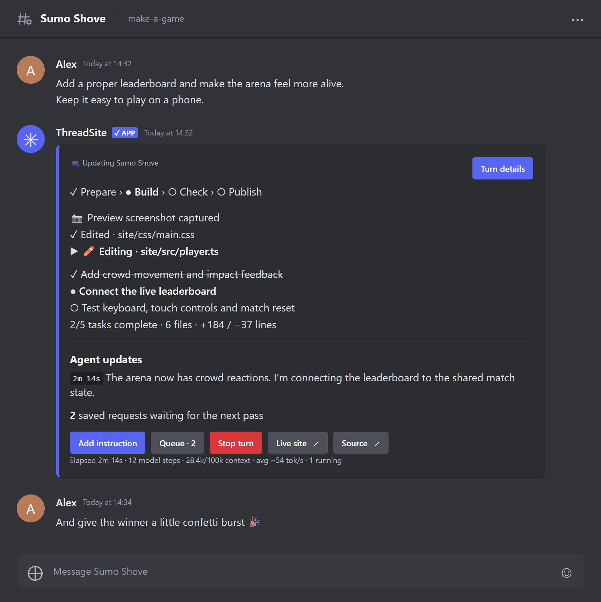
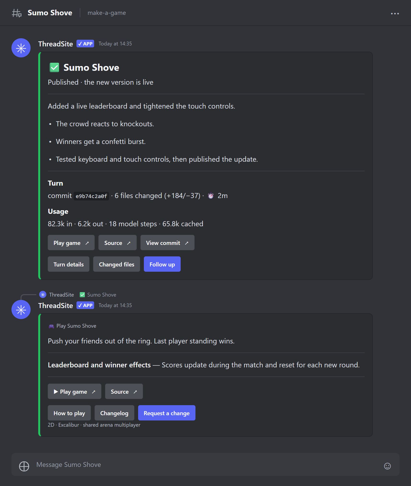
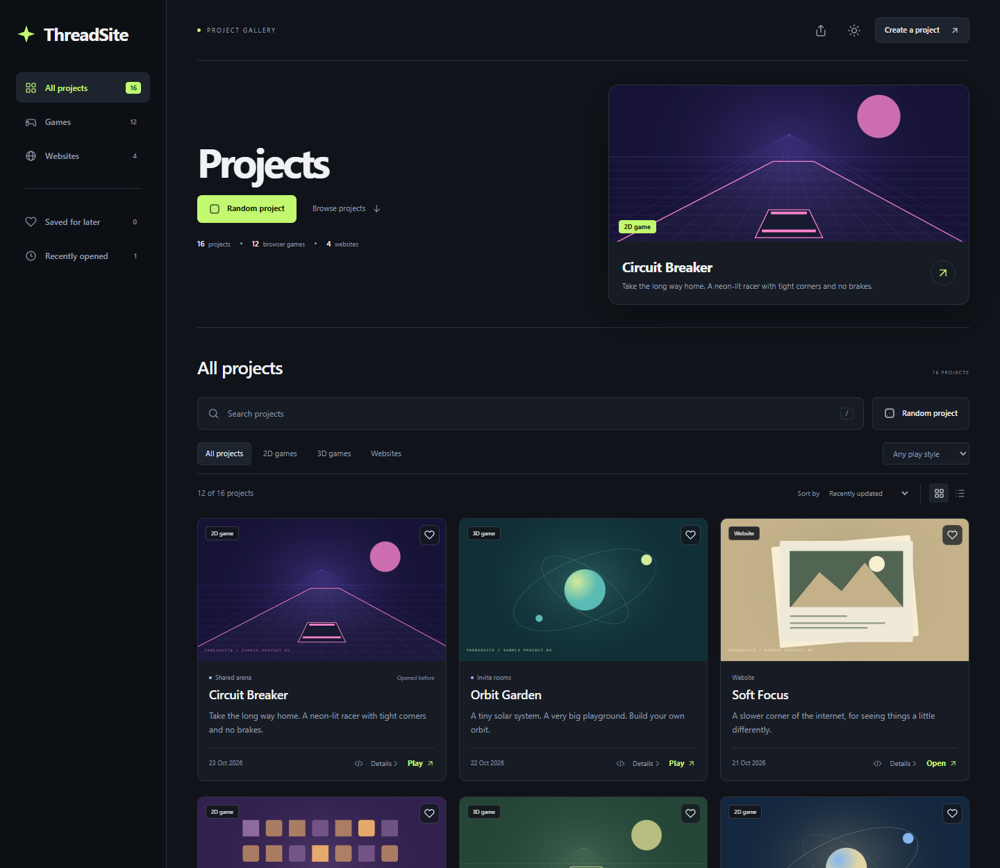

# ThreadSite

Build websites and browser games from Discord.

[](https://github.com/Siroro/threadsite/actions/workflows/ci.yml)
[](https://github.com/Siroro/threadsite/actions/workflows/multiplayer.yml)
[](LICENSE)

Start a project with a slash command, then reply in its thread to make changes. The bot builds and publishes your site or game, with a live link and a source repository for every project.



## Install

You'll need a Linux server, a domain and a [Discord bot token](docs/discord.md). Enable **Message Content Intent** when creating the bot.

Point your sites and Git hostnames at your server, and open ports **80 and 443**. Then run the interactive installer:

```bash
curl -fsSL https://raw.githubusercontent.com/Siroro/threadsite/main/scripts/caddy-quickstart.sh | bash
```

It asks for your exact sites and Git hostnames, such as `lab.example.com` and `git.example.com`, an optional games hostname, your Discord token and AI model settings. Leave the games hostname blank to share the sites address. Tokens are entered privately.

The installer offers to install missing tools and Docker, prints a Discord invite link, sets up HTTPS with Caddy and waits for the bot to connect. When it's done, try `/site start` in your Discord server. On reruns, press Enter to keep saved hostnames or enter `-` at the games prompt to share the sites address again.

See the [install guide](docs/deployment.md#caddy-quickstart) for custom domains, unattended installs and reruns. If you already run a web server or hosting panel, use the [existing server setup](docs/deployment.md#existing-server-setup).

## Usage

Create a website:

```text
/site start prompt: make a cosy recipe book for our server name: Server Cookbook
```

Or a game:

```text
/makegam dimension:2d prompt: make a top-down racing game for four players name: Tiny Racers
```

```text
/makegam dimension:3d prompt: make a hovercraft course with checkpoints name: Hover Yard
```

The bot opens a thread and shows its progress. When it's done, click **Open site** or **Play game**. Anyone with the link can open it in their browser.

To make changes, just reply:

> Add a night mode and make the text bigger.
>
> Give the hovercraft a boost button.

Attach images or files for reference, or reply while the bot is working to give it more instructions. The pinned card has the latest link, source code and project controls.



### Working together

Thread members can make changes by default. Use **Collaboration** on the pinned card to limit editing to chosen people or approve requests first.

**Queue** shows waiting requests. Use `/site stop` to stop the current work or `/site revert` to undo the last accepted update. See the [command guide](docs/commands.md) for all controls.

## Multiplayer

Games can use a shared arena, invite-code rooms or singleplayer mode. For example:

```text
/makegam dimension:2d multiplayer:rooms prompt: make a co-op dungeon crawler
```

ThreadSite includes the multiplayer server. Games can also use saved progress and global leaderboards, and fall back to solo play if multiplayer is unavailable. Change an existing game's mode with `/site multiplayer`, and clear a game's shared arena world and/or leaderboard scores with `/site wipe` or the pinned card's **Wipe state** form (the owner chooses who may reset in Collaboration).

See [multiplayer](docs/multiplayer.md) for modes, saves and hosting.

## Gallery

Published projects appear in a shared gallery. Search, filter by game type, save favourites or pick something at random.



## Docs

- [Discord setup](docs/discord.md): bot token, permissions and server invite
- [Commands](docs/commands.md): project controls, collaboration and admin commands
- [Multiplayer](docs/multiplayer.md): game modes, saves and leaderboards
- [Gallery](docs/gallery.md): browsing and sharing projects
- [Maintenance](docs/maintenance.md): updates, cleanup and tests
- [Architecture](docs/architecture.md) and [OpenCode](docs/opencode-v2.md): how it works
- [Physics comparison](docs/physics-comparison.md): Rapier versus Box3D features, local browser measurements and demo

For local development, use Node 24 and run the [checks](docs/maintenance.md#local-regression-checks) in the component you're changing. GitHub Actions runs the main checks on pushes and pull requests.

ThreadSite is [MIT licensed](LICENSE).
